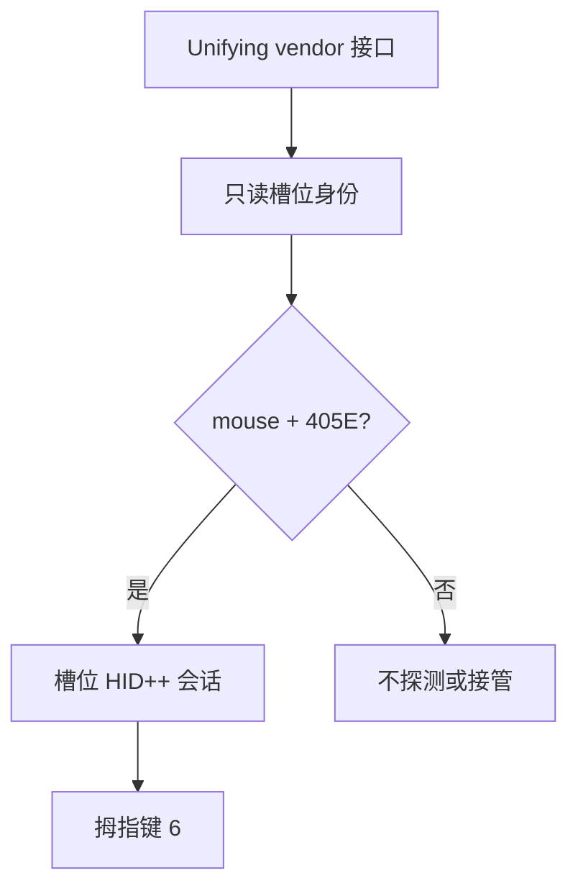

# M720 + Unifying 接收器适配

状态：受限接收器适配已接入，完整自检、更新助手、签名／构建元数据检查和隔离 Debug 包构建通过；**没有本项目的 M720 / Unifying 实机验证**。

## 范围

- 只接入标准 Unifying 接收器 `046D:C52B` / `046D:C532` 的专用 HID++ 接口。
- 同一接收器只选择一个最先确认的 M720：设备种类必须为 mouse（`2`），无线产品 ID 必须为 `0x405E`。不凭名称判断，也不向全部槽位盲发 HID++ 2.0 探测。
- 当前只接管 M720 的物理拇指控件 `0x00D0`，复用独立逻辑按键 `6`。普通前进／后退等按键仍走原有 CGEvent 映射，不承诺接收器下的物理长按增强。
- 不扩展 Bolt、Nano、Lightspeed、USB 有线、其他型号鼠标、同一接收器的多个 M720 或键盘配置。

## 为什么不是放开 USB 过滤

蓝牙直连由鼠标自己使用 `0xFF` 寻址；Unifying 的 `0xFF` 指接收器本身，鼠标在 `1...6` 的动态槽位。接收器还可能配对键盘，不能把每个槽位都当鼠标。

macOS 上专用 vendor 接口可能不出现在 IOHIDManager 枚举里，所以通过 IORegistry 的 `IOHIDDevice` 到达／移除通知发现。只有已知接收器 PID 且同时包含 `0xFF00/1`（短报告）和 `0xFF00/2`（长报告）的接口才允许打开；含普通键盘／鼠标 usage 的接口被拒绝。打开使用 `kIOHIDOptionsTypeNone`，不独占设备。



## 协议与生命周期

- 接收器寄存器使用 HID++ 1.0：读取通知 flags，保留其他 flags 并仅打开无线通知位，然后请求连接信息／读取配对信息 `0x2B5`。
- 配对寄存器的 WPID 是大端，连接通知的 WPID 是小端；解析必须区分两种形状。
- 一次只允许一个命令在途，物理传输队列有限容量，并按槽位、命令、函数和软件 ID 匹配响应。旧超时回复不能完成新请求，HID++ 1.0 的空槽位／离线错误不能拖死其他槽位发现。
- 传输使用私有串行 dispatch queue 和异步 output-report API，不让 USB/RF 等待占用事件 tap 的主 run loop。
- 只在配对信息或连接通知确认是 M720 后，才向该槽位发 `REPROG_CONTROLS_V4` 查询。专用接口也会收到其他配对设备的 vendor 报告，但未授权槽位的控件报告不记录、不投给按键管线。
- 鼠标断连／换槽位时取消其 claim，而不是把丢失的抬起解释成一次调度中心单击；其他鼠标仍持有的同编号按键不被一起释放。
- 失败只开有限重试窗口，并在重连、系统唤醒或重新录入时核对身份重试，不持续轮询空闲设备。
- 退出／停用时恢复自己尝试接管过的拇指控件；重新解析当前 feature index，而不是把旧索引当固定协议地址。恢复义务保留在物理传输层，即使逻辑会话失败也不能丢失。
- 恢复携带接管世代，旧恢复不能清掉后来的新接管。旧 HID 接口完成恢复与 cancellation handler 之前，不重新打开同一 registry ID 的接口。
- 退出在 tap 停止后做有限等待；RF 回复及恢复回调不依赖被等待的主线程。恢复失败／超时会写日志，不声称 IOKit 提交成功就等于硬件成功。
- 无线通知位是接收器共享状态，退出时不清除，避免关闭其他客户端的通知；不改配对、不改原厂 target CID、不写持久 divert 位。

## 依据与许可证边界

实现使用协议事实与 Apple API，没有引入第三方驱动或依赖，也没有复制其他项目实现代码。

- [Logitech HID++ 1.0 Unifying 公共规格](https://lekensteyn.nl/files/logitech/logitech_hidpp10_specification_for_Unifying_Receivers.pdf)：19 页，报告格式、1–6 槽位、通知寄存器、`0x40/0x41` 连接通知、配对信息与错误格式。
- [Solaar 接收器标识](https://github.com/pwr-Solaar/Solaar/blob/master/lib/logitech_receiver/base_usb.py)：C52B / C532 为标准 Unifying，不能与 Nano / Bolt 混用发现策略。
- [Solaar 设备表](https://pwr-solaar.github.io/Solaar/devices/)及 [libratbag M720 设备标识](https://github.com/libratbag/libratbag/commit/364e3fd965912425798a961b54b0eb0248a91954)：M720 无线 WPID `405E`，蓝牙 ID `B015`。
- [RaTamer macOS HID++ 调研](https://github.com/gilsonolegario/RaTamer/blob/main/docs/HIDPP.md)：专用接口发现、短／长报告、output-report 传输与冷启动延迟。
- Apple SDK `IOKit/hid/IOHIDDevice.h`：dispatch queue 只能设置一次，不能与 run loop 混用；注册回调须在 activate 前；device / buffer 必须保留到 cancellation handler 完成。
- M720 控件 `0x00D0` 的依据见 [蓝牙拇指键说明](m720-thumb-button.md)。

## 自动检查

新增自检不仅检查协议常量，还以模拟 output/input 驱动实际 `LogitechUnifyingTransport` 和 `LogitechUnifyingReceiver`：

- vendor usage / VID / PID 过滤，槽位 1–6 的只读查询、两种 WPID 字节序、无线 flags 保留；
- 一个在途命令、队列容量、跨槽位／software ID／配对子寄存器回复拒绝，以及两种错误格式；
- 默认拒绝外设槽位、M720 身份授权、接管世代、失败 ACK 不丢失恢复义务、键盘替换取消旧租约；
- 实际借用会话的槽位编码与 thumb-only 接管、重复状态与丢失 up；
- 实际传输在主线程不处理回调时完成恢复／关闭，并重新解析 feature index 从 `0x0B` 变为 `0x17`；
- 实际接收器流程先遇到键盘槽位 1、空槽位 2，再找到 M720 槽位 3；随后槽位 3 变键盘、M720 重连到槽位 5，验证不探测键盘、不重启也能恢复。

模拟驱动不打开 IOKit 设备，也不创建输入 tap。它能覆盖队列和状态流转，不能证明 USB/RF 硬件实际接受命令。

验证结果：

- `make test`：688 项应用自检全部通过，接收器阶段新增 83 项；更新助手、6 项发布签名、16 项社区签名、26 项构建元数据检查全部通过。
- 隔离 Debug 包主程序与更新助手的 SDK 27.2 / 最低 macOS 14.0 元数据检查及固定社区身份签名验证通过。
- 组装后直接运行 Debug 主程序 `--self-check`：688 项全部通过。

## 测试包

`build/OpenMouse-M720-Debug-arm64.zip` 包含更新后的 `Open Mouse Debug.app`，同时包含蓝牙与受限 Unifying 适配。这是 **Apple Silicon / arm64** 的未公证、固定社区身份签名测试包，不是正式发布；Intel Mac 需要另行构建 x86_64 包。配置目录与 TCC 身份均与正式版隔离。

## 反馈者回测重点

使用隔离的 `Open Mouse Debug.app`，退出正式版及 Logi Options+ 等同类工具，授予测试包辅助功能与输入监控权限。

1. **确认真的使用 Unifying**：关闭 M720 的蓝牙连接，用接收器连通鼠标，并提供接收器 PID、macOS 版本和 Mac 架构。
2. **首次录入**：打开按键录入，按拇指托的隐藏键，应显示「拇指键」。绑定自定义 `⌘C` 并保存，在文本编辑器选中文字检查复制。冷启动／刚唤醒时先等 `HID++ discovery ready`，再判断是否能录入，记录首次唤醒按下与后续按下有无差异。
3. **混合配对**：如接收器同时连接键盘，检查真实键盘输入完全正常；只有 M720 槽位出现在控件发现／接管日志中。
4. **手势**：单击、上／下、左／右；桌面边界静默不算失败，指针所在显示器应有可切换空间。
5. **重连**：鼠标关闭／打开、休眠／活动、接收器拔插、系统睡眠／唤醒，以及重新配对到不同槽位，确认不需要重启 App 才恢复。
6. **恢复**：删除最后一条拇指绑定、关闭总开关和退出测试 App，确认原厂动作恢复；快速关闭／重开总开关，不能被旧恢复关掉新接管。
7. **异常会话**：按住拇指时让鼠标断连，不能误弹调度中心；同时操作另一只鼠标时，不应清掉它的按住状态。

诊断日志：

```bash
/usr/bin/log show --last 5m --predicate 'subsystem == "com.openmouse.OpenMouse" && category == "hidpp"' --info
```

重点找 `Unifying vendor interface`、`M720 identified slot=... wpid=0x405e`、`control cid=0xd0 button=6`、`divert=true/false`、`activeButtons`，以及 request timeout / restore / open failed。**纯逻辑自检、签名验证和构建成功都不能替代这些实机回测。**
